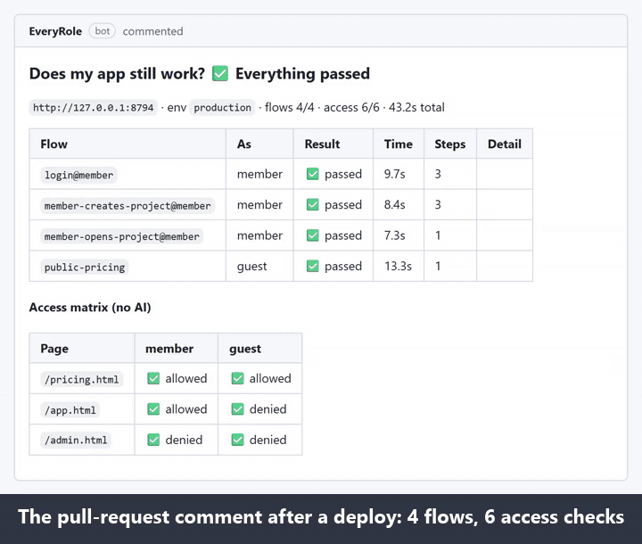

<div align="center">


### Plain-English end-to-end tests for every kind of user, on every deploy.

[](https://github.com/mkraiemm/everyrole/actions/workflows/ci.yml)
[](LICENSE)
[](pyproject.toml)



</div>

Write what a user should be able to do, in plain English, in a small JSON file. On every deploy, EveryRole opens
your app in a real Chrome, signed out or signed in as each kind of user, does it, and tells you on the pull
request what broke, for whom, and at which step, with a replay video.

```json
{
  "name": "member-opens-project",
  "as": "member",
  "start": "{{BASE_URL}}/app",
  "goal": "Open the project called Launch plan.",
  "expect": [{ "text_visible": "Opened project: Launch plan" }]
}
```

## Why it's different

- **Plain-English tests that survive UI changes.** No selectors, no click scripts. A small model
  ([Jev](https://typesafe.ai)) picks each click from what the page shows, so a changed class name, layout or
  component library does not break the test. Pass or fail still comes only from your checks, never from the AI.
- **Tests every kind of user, including who can open what.** Sign in once per user type (admin, paid, free,
  visitor), run a flow as each of them with different expectations, and check an access matrix of who may open
  which page, with no AI at all.
- **Honest results: your app vs. our machine, never confused.** "Your app is broken", "EveryRole could not check
  (Chrome or the model provider had a problem)" and "passed on the 2nd try" are three different results. Only
  the first turns a pull request red.

Also: forms tested without saving (every write blocked, the save attempt checked), secrets that never reach a
model, apps spread over several addresses (`app.example.com` + `example.com`), and a run that stays inside a
memory, CPU and network budget and leaves no browser process behind. It runs on your machine or CI with your own
AI key.

## 30-second quick start

```bash
pip install git+https://github.com/mkraiemm/everyrole.git
echo "TYPESAFE_API_KEY=your-key" > .env      # plus TYPESAFE_URL / TYPESAFE_MODEL for the Vercel AI Gateway
everyrole doctor                                # Chrome, keys, provider: ready?
```

`flows/pricing.json`:

```json
{
  "name": "visitor-finds-pricing",
  "start": "{{BASE_URL}}/",
  "goal": "Open the pricing page.",
  "expect": [{ "url_contains": "/pricing" }]
}
```

```bash
everyrole run flows --base-url https://your-app.example.com --videos
```

EveryRole launches a throwaway headless Chrome, runs the flows in parallel, prints the pull-request comment and
writes `everyrole-report/` (`summary.md`, `results.json`, `junit.xml`, `usage.json`, screenshots,
`videos/*.mp4`).

| Command | What it does |
|---|---|
| `everyrole doctor` | Is this machine ready? Python, Chrome, ffmpeg, keys, provider, and a tiny call to each model |
| `everyrole validate flows` | Checks flow and config files against the schemas, offline |
| `everyrole run flows --base-url URL` | Runs the flows and access rules; exit 1 when the app is broken |
| `everyrole signin --persona NAME` | Signs in as one user type, exactly as a run does, and says where it landed |
| `everyrole comment` | Posts or updates the report as one pull-request comment (GitHub Actions) |
| `everyrole ci --app NAME` | In your CI: runs an app's tests kept in EveryRole, with logins only your CI has ([Run in your own CI](#run-in-your-own-ci)) |

No app at hand? The repository has a demo app and its checks: [Getting started](docs/getting-started.md).

## How it compares

|  | EveryRole | Playwright / Cypress tests written by hand | Recorders (Playwright codegen, Chrome DevTools Recorder, Selenium IDE) |
|---|---|---|---|
| What you write | Goal in plain English + checks (JSON) | Code: locators, actions, assertions | Nothing: you click, it generates a script |
| When markup or layout changes | No locators to update; the model picks the control from the page | Update locators (role/text locators break less than CSS ones) | Re-record or edit the generated locators |
| Who decides pass/fail | Your checks, on the loaded page | Your assertions | Generated or hand-added assertions |
| Several user types + access matrix | Built in (`personas`, `access`); the matrix needs no AI | You build it (fixtures, storage state) | You record each variant |
| "App broken" vs. "machine problem" | Separate results; machine problems never fail a PR on their own | A browser crash or timeout fails the test like a bug; retries can mark tests flaky | Same as the scripts they generate |
| Forms without saving | `block_writes` + `tried_to_save` | Possible with request interception you write | Not by default |
| Speed per step | A model call per decision (slower than a script) | Milliseconds | Milliseconds |
| Cost per run | Model calls on your own key | Free (your CI time) | Free (your CI time) |
| Determinism | Checks are deterministic; the path taken can vary | Fully scripted | Fully scripted |
| Best for | "Does the product still work for each kind of user" on every deploy | Precise, fast, fully controlled tests | Getting a first script quickly |

They work well together: keep precise tests in code, and let EveryRole check the user journeys that code tests
tend to miss or that break every time the UI moves.

## How it works

```mermaid
flowchart LR
    F["flows/*.json<br/>everyrole.config.json"] --> S["everyrole run"]
    S -->|"once per user type"| L["sign in, save session"]
    S --> P["flows + access checks<br/>in parallel, isolated"]
    L --> P
    P --> A["model picks the next click<br/>(sees value names, never secrets)"]
    A --> G["guards in code:<br/>forbid words, allowed hosts,<br/>write-guard"]
    G --> B["Chrome"]
    B --> C["checks read the loaded page"]
    C --> V["verdict: passed / failed /<br/>not checked / not run"]
    V --> R["PR comment, JUnit,<br/>results.json, replay videos"]
```



1. Each user type signs in once; its session is restored into each of its flows.
2. For each step the model chooses an action among the page's controls. EveryRole checks it against your
   `forbid` words and allowed hosts before anything happens, and types secret values itself.
3. After each step, EveryRole reads the page (URL, text, controls, blocked save attempts) and evaluates your
   checks once the page has finished loading. The model's "done" is never trusted.
4. Anything that did not pass is retried once; every result carries its cause (app, machine, setup, skipped).
5. The report becomes one PR comment, updated in place, plus JUnit, JSON and a replay video per flow.

More: [Architecture](docs/architecture.md).

## Writing flows

Three flows for the demo app, each harder than the last (full tutorial: [Writing flows](docs/writing-flows.md)):

**A public page**

```json
{
  "name": "public-pricing",
  "start": "{{BASE_URL}}/index.html",
  "goal": "Open the pricing page.",
  "expect": [{ "url_contains": "/pricing.html" }, { "text_visible": "$12 per user per month" }]
}
```

**A signed-in user action**, as the `member` user type from `everyrole.config.json`:

```json
{
  "name": "member-opens-project",
  "as": "member",
  "start": "{{BASE_URL}}/app.html",
  "goal": "Open the project called Launch plan.",
  "expect": [{ "url_contains": "#/projects/launch-plan" }, { "text_visible": "Opened project: Launch plan" }],
  "forbid": ["Delete", "Sign out"]
}
```

**A form tested without saving**: every write is blocked, and the check proves the form tried to save.

```json
{
  "name": "member-creates-project",
  "as": "member",
  "start": "{{BASE_URL}}/app.html",
  "goal": "Create a new project using the project name value.",
  "values": { "project_name": "Quarterly review {{RUN_ID}}" },
  "block_writes": true,
  "ignore_saves": ["/api/metrics"],
  "expect": [{ "text_visible": "Create a project" }, { "tried_to_save": "/api/projects" }],
  "forbid": ["Delete", "Sign out"]
}
```

Every field: [Flow and config reference](docs/flow-spec.md). User types and access rules:
[User types](docs/user-types.md).

## On every deploy

```yaml
# .github/workflows/everyrole.yml
on: deployment_status
permissions: { contents: read, pull-requests: write, issues: write }
jobs:
  flows:
    if: github.event.deployment_status.state == 'success'
    runs-on: ubuntu-latest
    steps:
      - uses: actions/checkout@v4
      - uses: mkraiemm/everyrole@v0
        with:
          base-url: ${{ github.event.deployment_status.environment_url }}
        env:
          TYPESAFE_API_KEY: ${{ secrets.TYPESAFE_API_KEY }}
          TYPESAFE_URL: ${{ vars.TYPESAFE_URL }}
          TYPESAFE_MODEL: ${{ vars.TYPESAFE_MODEL }}
          QA_EMAIL: ${{ secrets.QA_EMAIL }}
          QA_PASSWORD: ${{ secrets.QA_PASSWORD }}
```

One PR comment, updated in place; the report and replay videos as an artifact; "nothing could be checked"
labelled as a machine problem, not an app failure. Vercel previews: [`examples/github/everyrole.yml`](examples/github/everyrole.yml).
GitHub details: [GitHub Action](docs/github-action.md). GitLab and any other CI: [CI](docs/ci.md).

## Run in your own CI

If your tests live in [EveryRole](https://everyrole.dev), your own CI can run them: the tests come from
EveryRole, the test logins stay in your CI. `everyrole ci --app <your app>`, in a GitLab or GitHub job:

1. asks EveryRole for the app's tests (with a workspace API key, `EVERYROLE_API_KEY`);
2. reads each kind of user's login from two masked CI variables, `EVERYROLE_LOGIN_<KIND>_USERNAME` and
   `EVERYROLE_LOGIN_<KIND>_PASSWORD` (a missing one is named, and nothing runs);
3. runs the tests in the job's own browser. The runner types each login itself; the AI model calls go through
   EveryRole with the API key (no model key of your own), and only ever see a value's name, never the value;
4. uploads the results (verdicts, failing steps, pictures, replays: never a login) so the run shows in EveryRole,
   keeps them in `everyrole-report/` (`junit.xml` for the CI's test report) and, with `--comment`, comments on the
   merge request or pull request.

Exit code: `0` every test passed, `1` a test is broken, `2` nothing could be checked (a missing variable, a
refused key...).

GitLab: copy [`everyrole/ci_files/everyrole.gitlab-ci.yml`](everyrole/ci_files/everyrole.gitlab-ci.yml) into
your `.gitlab-ci.yml` (EveryRole fills it in for your app in Settings). It runs in the `test` stage, so it works when it is the only job: GitLab starts no pipeline whose only jobs
are in `.pre` or `.post`. If your pipeline has other jobs (a deploy job), change it to `stage: .post` so the
tests run last, after your deploy; if your file lists its own `stages:` without `test`, use one of yours. GitHub: the action takes `app` and
`api-key`:

```yaml
      - uses: mkraiemm/everyrole@main
        with:
          app: your-app
          api-key: ${{ secrets.EVERYROLE_API_KEY }}
        env:
          EVERYROLE_LOGIN_ADMIN_USERNAME: ${{ secrets.EVERYROLE_LOGIN_ADMIN_USERNAME }}
          EVERYROLE_LOGIN_ADMIN_PASSWORD: ${{ secrets.EVERYROLE_LOGIN_ADMIN_PASSWORD }}
```

Setup, variables and options: [everyrole.dev/docs#ci](https://everyrole.dev/docs#ci).

## Security

- **Secrets never reach a model.** The model sees only the *name* of a value ("password"); EveryRole types the
  literal. Every model request passes one redaction filter, password fields are reported as "filled" or empty,
  and reports are scrubbed the same way.
- **Write-guard.** With `block_writes`, every POST/PUT/PATCH/DELETE, form post and beacon is blocked inside
  the page.
- **Forbid words and allowed hosts.** Checked in code before every action.
- **Isolation.** A browser context per flow, a throwaway Chrome profile, sessions in a private temp folder.

Limits and recommendations: [Security model](docs/security.md).

## Bring your own AI key

| Variable | Needed | What for |
|---|---|---|
| `TYPESAFE_API_KEY` | yes | Jev, the model that chooses each action |
| `TYPESAFE_URL`, `TYPESAFE_MODEL` | with the Vercel AI Gateway | `https://ai-gateway.vercel.sh/typesafe/v1/systemone`, `typesafe-ai/jev`. Omit both for TypeSafe directly |
| `TEXT_MODEL_API_KEY`, `TEXT_MODEL_BASE_URL`, `TEXT_MODEL` | optional | Any OpenAI-compatible model, only for fields none of the flow's `values` fits |

With your own flows and key: no EveryRole server, no telemetry. Details: [Bring your own AI key](docs/ai-keys.md).

## Limits

- Two-factor codes, CAPTCHAs and emailed links cannot be typed: such a sign-in is reported as "sign in
  yourself" (never as a failure), and a session saved by hand can be reused (`saved_signin`).
- The model reads page text and controls, not pixels: `<canvas>` content cannot be clicked or checked.
- Checks cover what the page shows, not your database.
- The write-guard runs inside the page (not service workers or WebSockets); keep risky words in `forbid`.
- Chrome, Chromium or Edge only. Vercel previews behind Deployment Protection cannot be tested yet.

## Documentation

[Getting started](docs/getting-started.md) · [Writing flows](docs/writing-flows.md) ·
[Reference](docs/flow-spec.md) · [User types](docs/user-types.md) · [Honest results](docs/verdicts.md) ·
[Replays and reports](docs/replays-and-reports.md) · [GitHub Action](docs/github-action.md) · [CI](docs/ci.md) ·
[Security](docs/security.md) · [AI keys](docs/ai-keys.md) · [Troubleshooting](docs/troubleshooting.md) ·
[FAQ](docs/faq.md) · [Architecture](docs/architecture.md) · [Contributing](CONTRIBUTING.md) ·
[AGENTS.md](AGENTS.md) (the code base in one page, for AI coding agents and new contributors) ·
[Changelog](CHANGELOG.md)

## License

MIT, see [LICENSE](LICENSE). Includes a modified copy of
[jev-ultrafast](https://github.com/browser-use/jev-ultrafast) (MIT, Browser Use) under `engine/`; every change
is listed in [engine/PATCHES.md](engine/PATCHES.md).

---

<div align="center">

**If EveryRole saves you from a broken deploy, please ⭐ star the project.**

</div>
