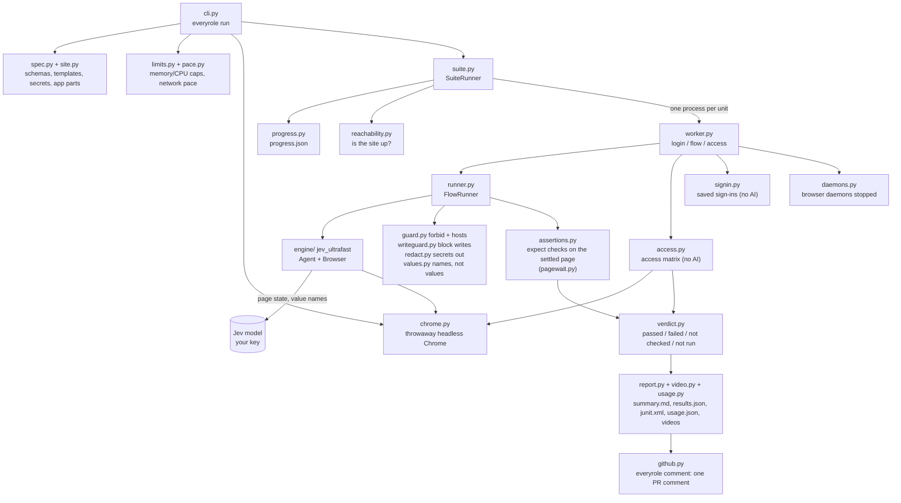

# Architecture

How `everyrole run` turns JSON files into a verdict. Module names are files in [`everyrole/`](../everyrole) unless
marked `engine/`.

## The pieces

**`cli.py`** parses the command (`validate`, `run`, `signin`, `doctor`, `comment`), loads `.env` (never
overriding real environment variables), loads and validates the config and flows, sets up the run's limits,
starts Chrome, runs the suite, writes the report and returns the exit code.

**`site.py`** knows where the app lives: one address given with `--base-url`, or several named parts per
environment (`environments` in the config). Pages are written `/path` on the main part and `part:/path` on the
others.

**`spec.py`** validates flow and config files against the JSON schemas in `everyrole/schema/`, fills in schema
defaults, expands a flow into one run per user type (`as`), and resolves templates. It records every secret a
flow uses, so the runner can redact exactly those values.

**`chrome.py`** finds Chrome (`CHROME_PATH`, `PATH`, standard locations), starts it headless on a free port with
a temporary profile, and can heal it: if the DevTools endpoint stops answering, a Chrome EveryRole launched itself is
restarted before a retry. A Chrome given with `--cdp-url` is never restarted.

**`limits.py`** holds a run to a share of the computer (`run.limits`): before any browser starts, the run
gets a container the operating system enforces (a job object on Windows, a cgroup v2 group on Linux), and every
worker and Chrome runs inside it. On top of that, a governor starts a new worker only when it fits under the
caps, so a run slows down instead of hitting the wall. **`pace.py`** paces page loads across every process of
the run (`run.network`): a bounded number of pages loading at once, and gaps between new pages that follow how
fast pages really load. When the app's address stops resolving, nothing new starts until it does again.

**`suite.py`** (`SuiteRunner`) orchestrates one run:

1. **Pre-check** (`reachability.py`): the site must answer. If it does not while the model provider does, the
   site is down (one app failure, everything else "not run"); if neither does, the machine is offline.
2. **Sign-ins**: every needed user type signs in once, in parallel, and saves its session to a private temporary
   folder (`session.py`). A user type with a `saved_signin` has its saved session checked instead, with no AI
   (`signin.py`).
3. **Flows and access checks**, in parallel (`run.parallel`), each restoring its user type's session. Access
   rules run in batches of `run.access_batch` pages.

It writes `progress.json` in the report folder as units start and finish (`progress.py`), for anything that
wants to show a run live.
4. **Retries**: every unit that did not pass is tried once more, after healing the browser for machine
   problems. A second-try pass is reported with a warning.

Each unit runs in its own process (`python -m everyrole.worker ...`) with its own browser-driving daemon, all
against the same Chrome. A crashed or hung worker becomes a "not checked" result, never a crashed suite.
Every daemon registers in a folder of the run (`daemons.py`); each worker stops its own when it ends, the suite
stops those of a worker it had to kill (and closes the tabs it left open), and the command stops whatever is
left when it ends. No browser daemon outlives its run.

**`runner.py`** (`FlowRunner`) runs one flow:

- opens `start` in an isolated browser context; before the first page load it restores the session, installs
  the network tracker (`pagewait.py`) and, for form-only flows, the write-guard (`writeguard.py`);
- drives the engine's `Agent`, with hooks: `before_execute` (the `forbid` guard, `guard.py`), a `text_provider`
  that lets Jev choose a value *name* and types the literal locally (`values.py`), and waits for the page to
  settle after each action;
- after every step, reads the page itself (URL, text, visible controls, blocked writes) and evaluates the
  `expect` checks (`assertions.py`). It stops early only when the checks hold on a settled page; loading
  screens never pass;
- when the model gives up but the page continues below, scrolls and lets it try again (`scroll_retries`);
- decides the status from the checks alone, sets the `cause`, takes a screenshot on failure and builds the
  replay video (`video.py`);
- registers a redaction filter on the engine's single outbound choke point (`OUTBOUND_FILTERS`) for the whole
  flow, and scrubs the result before returning it.

**`access.py`** (`AccessChecker`) opens a batch of pages a user type has rules for, in parallel tabs sharing
one browser session, and watches for a redirect or a `denied_when` match. No model involved. Disagreements and
unreadable pages are re-checked alone.

**`challenge.py`** recognises security checks (CAPTCHAs) by where their frames and scripts load from
(`challenges.json`). A test or sign-in that stops on one is "sign in yourself", never an app failure.

**`verdict.py`** maps every result to `passed`, `failed`, `not_checked` or `not_run` from its `cause`
(`app`, `machine`, `setup`, `skipped`, `signin`). Only `app` (and `setup`) failures count as failures.

**`report.py`** writes `summary.md` (the PR comment), `results.json` and `junit.xml`; **`usage.py`** writes
`usage.json`, what the run used of the models as the provider reported it (calls, tokens, cost when given). **`github.py`** finds the
pull request (from the event, or from the deployed commit for `deployment_status`) and creates or updates one
comment, found by a hidden marker.

## The engine (`engine/jev_ultrafast`)

A vendored copy of [jev-ultrafast](https://github.com/browser-use/jev-ultrafast) (MIT, Browser Use):

- `browser.py` drives one tab through Chrome DevTools, via a
  [browser-harness](https://pypi.org/project/browser-harness/) daemon;
- `snapshot.js` lists the page's visible, actionable elements (password values are reported only as
  "filled" or empty);
- `model.py` asks Jev typed questions ("which operation?", "which element?") and gets choices with
  probabilities; every request passes through `OUTBOUND_FILTERS`;
- `agent.py` loops observe → decide → act, with the hooks EveryRole uses.

EveryRole's changes to the engine are small and listed one by one in [engine/PATCHES.md](../engine/PATCHES.md).

## Design rules

- **Pass/fail is deterministic**: only checks on the page decide. The model is a navigator, not a judge.
- **Safety in code, not in prompts**: forbid words, allowed hosts, write-guard and redaction run before or
  around every model call and browser action.
- **Machine problems are never app failures**: every failure carries the cause from where it happened.
- **Isolation**: one process, one browser context and one daemon per unit; sessions in a private temp folder.
- **A good neighbour**: a run stays inside its memory, CPU and network budget, and leaves no process behind.
