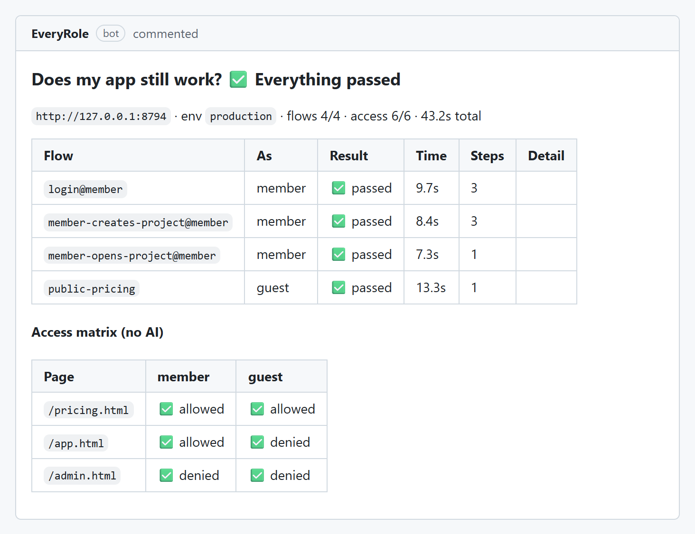

# Replays and reports

Every `everyrole run` writes a report folder (`--output`, default `everyrole-report/`) and prints the pull-request
comment to the terminal. Secret values are replaced by `[secret:NAME]` everywhere before anything is written.

```
everyrole-report/
  summary.md              the pull-request comment (markdown)
  results.json            every flow, check, step, timing and access row
  junit.xml               for CI test views
  usage.json              what the run used of the models (calls, tokens, cost when the provider reports it)
  progress.json           the run's live state: each unit queued / running / passed / failed ..., with times
  <flow>.jpg              screenshot of the page where a flow did not pass
  videos/<flow>.mp4       replay at real speed (with --videos and ffmpeg)
  videos/<flow>.jpg       the page the checks were judged on, for passing flows too (with --videos)
```

## The pull-request comment (`summary.md`)

- A headline: `✅ Everything passed`, `❌ 2 of 11 checks failed`, or
  `✅ Nothing broken found · ⚠️ 1 of 11 could not be checked (machine problem, not your app)`.
- The deploy URL, environment, flows passed, access checks passed, total time.
- One row per flow (and per user type): result, time, steps, and for failures the check that failed with
  what was found instead.
- For failing flows, a collapsible list of the steps taken.
- Warnings, for example "first try failed (...); tried again".
- The access matrix, one column per user type.

The first line is a hidden marker (`<!-- everyrole-report -->`): `everyrole comment` uses it to update the same
comment on every run instead of adding new ones.

Real output of the quickstart (`examples/quickstart`) against the demo app:

```
<!-- everyrole-report -->
### Does my app still work? ✅ Everything passed

`http://127.0.0.1:8794` · env `production` · flows 4/4 · access 6/6 · 43.2s total

| Flow | As | Result | Time | Steps | Detail |
|---|---|---|---|---|---|
| `login@member` | member | ✅ passed | 9.7s | 3 |  |
| `member-creates-project@member` | member | ✅ passed | 8.4s | 3 |  |
| `member-opens-project@member` | member | ✅ passed | 7.3s | 1 |  |
| `public-pricing` | guest | ✅ passed | 13.3s | 1 |  |

#### Access matrix (no AI)

| Page | member | guest |
|---|---|---|
| `/pricing.html` | ✅ allowed | ✅ allowed |
| `/app.html` | ✅ allowed | ✅ denied |
| `/admin.html` | ✅ denied | ✅ denied |
```

The same comment rendered in a GitHub-style page with `scripts/render_pr_comment.py`:



## `results.json`

Three keys: `summary` (counts: `total`, `passed`, `failed`, `not_checked`, `not_run`, `access_total`,
`access_passed`, plus `duration_ms`, `base_url`, `environment`, `input_tokens`), `results` and `access`.

Each entry of `results` is one sign-in (`login@<persona>`) or one flow run:

| Field | Meaning |
|---|---|
| `name`, `persona`, `source` | Flow id (with `@persona`), user type, flow file |
| `status` | `passed`, `failed_expect`, `blocked`, `budget_exceeded`, `forbidden_action`, `left_allowed_hosts`, `error` |
| `passed`, `cause` | Did it pass; if not, why: `app`, `machine`, `setup`, `skipped`, `signin` ([verdicts](verdicts.md)) |
| `expectations` | Each check: `kind`, `expected`, `passed`, `detail` (what was found) |
| `steps` | Each action: `step`, `action` (the label), `kind`, `text`, `url`, model `probability` and `confidence`, timings |
| `decisions`, `input_tokens`, `usage` | Model decisions made, input tokens used, and every usage field the provider reported, per model (`engine`, `text`) |
| `challenge` | The security check (CAPTCHA) found on the page where it stopped, if any |
| `final_url`, `error`, `warnings` | Where it ended, what went wrong, retries and other notes |
| `attempts` | `2` when the first try did not pass |
| `screenshot`, `video`, `poster`, `timeline` | Files for failures and replays; `timeline` holds the step captions with their times |

Each entry of `access`: `path`, `persona`, `expected` (`allow`/`deny`), `observed` (`allowed`/`denied`/`error`),
`passed`, `url` (where the browser landed), `detail` (e.g. `redirected to /login.html`), `cause`.

## JUnit (`junit.xml`)

One `<testcase>` per flow run and per access check. App failures are `<failure>`; "not checked" and "not run"
are `<skipped>` with the reason, so CI test views never show a machine problem as a broken test.

## Replay videos

With `--videos`, each flow records a frame whenever the page is observed. When the flow ends, EveryRole adds the
page the checks were judged on as the last frame and encodes an MP4 in which every frame stays on screen for
as long as it really did: the replay plays at the speed the flow ran, and the last frame is held a little
longer. Without ffmpeg (on `PATH` or `FFMPEG_PATH`), no video is made and the run continues.

In GitHub Actions the report folder, videos included, is uploaded as the `everyrole-report` artifact, and the PR
comment links to the run.
